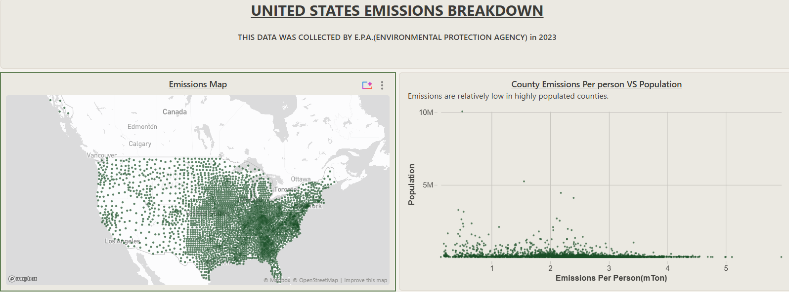
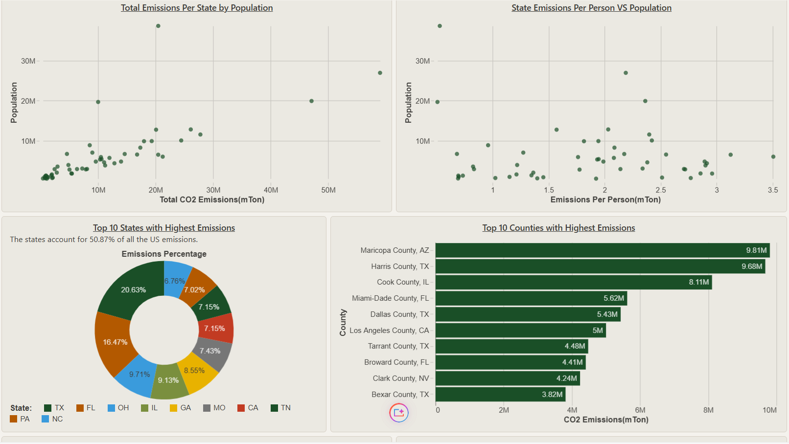
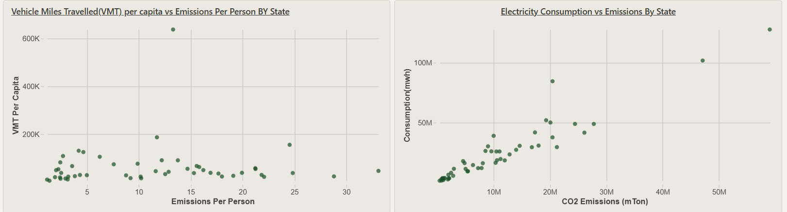

# US Carbon Emissions Analysis

###  Project Overview
Analyzed the total and per person carbon emissions based on state and counties.
I then dug deeper by analyzing the dataset by breaking down the carbon emissions relation to population, miles travelled by vehicle and electricity consumption.

### Data Processing
* **Data cleaning:** I used SQL and Databricks Genie to standardize the data.
* **Extracting Data:** I used SQL editor to breakdown the dataset to multiple tables showing relevant data.
* **Data Core Components:** Analyzed the carbon emissions based on: States, Counties, Population, Miles travelled by vehicle and Electricity consumption.

### 📊 Dashboard Architecture 
1. **Map**
    Shows the carbon emissions concentration based on the specific locations.
2. **States Breakdown**
    Broke down the total and per person carbon emissions per state based on population, Vehicle movements and Electricity consumption.
3. **Counties Breakdown**
    Broke down the total and per person carbon emissions per county based on population and ranked the top counties.

###  Visual Layout Previews
* **Map and County Emissions per person:**
 

* **States Emissions and top 10 states and counties:**
 

* **States Electricity consumption and Vehicles movements:**
 

### 🚀 Code Base & Pipelines
* [Download Compiled Summary Report (PDF)](US_Emissions_data.pdf)
* [Browse Individual Processing Query Scripts](scripts/)
